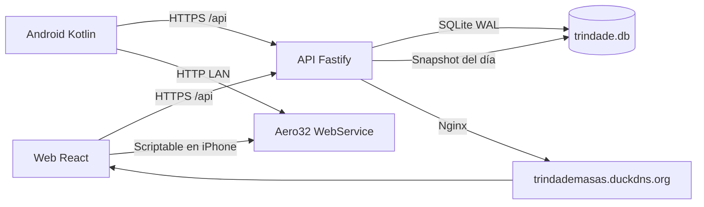
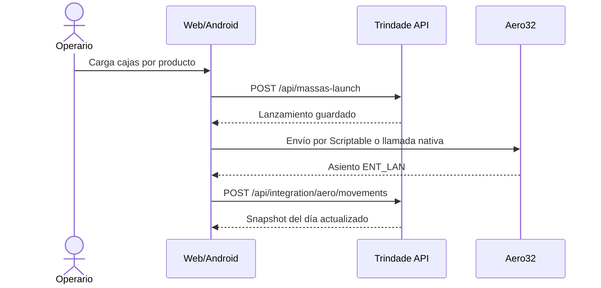
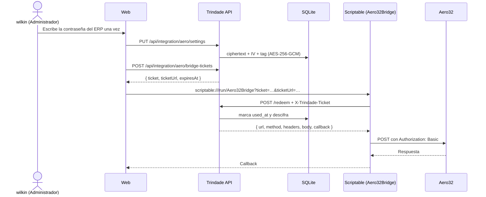

# Arquitectura de Trindade Massas

Esta guía describe cómo está armado el sistema que corre hoy: el monorepo, los módulos de cada paquete, las
rutas principales, el modelo de datos y los flujos que cruzan web, Android y el ERP Aero32.

## 1. Vista general

- **Web:** SPA React servida por Nginx en un contenedor.
- **API:** Fastify sobre Node 24, con SQLite en modo WAL y migraciones explícitas.
- **Android:** cliente nativo Kotlin/Compose que consume la misma API y, en la red de la fábrica, llama
  directamente al WebService Aero32.
- **ERP:** Aero32 se alcanza por HTTP local. La web usa **Scriptable** en el iPhone como puente; Android llama
  directo. La contraseña del WebService vive cifrada en el servidor y la web solo recibe un ticket de un solo uso
  que el script canjea por el sobre del pedido: la página nunca ve la credencial.
- **Persistencia:** un volumen Docker externo guarda la base y las fotos de reportes.

## 2. Monorepo

| Paquete | Tecnología | Responsabilidad |
| --- | --- | --- |
| `packages/backend` | Node 24, Fastify 5, TypeScript, Zod, better-sqlite3 | API, autenticación, reglas de negocio, migraciones y contrato |
| `packages/frontend` | React 19, TypeScript, Vite 6, TailwindCSS | SPA responsive para escritorio y móvil |
| `packages/android` | Kotlin 2.4.20, Jetpack Compose, Hilt, Retrofit 3 | Cliente nativo con paridad funcional |
| `packages/contracts` | OpenAPI 3.1 generado | Contrato legible por clientes y verificado en CI |

Directorios de apoyo:

- `docker/`: Dockerfiles, configuración de Nginx y plantillas de despliegue.
- `scripts/`: CI, respaldos, restauración, generación de contrato y utilidades de Aero32.
- `docs/`: documentación operativa y técnica.
- `odd/tasks/`: tareas de ingeniería históricas.
- `openspec/`: especificaciones y archivos de diseño históricos.

## 3. Backend

### 3.1 Módulos

| Módulo | Prefijo | Responsabilidad |
| --- | --- | --- |
| `auth` | `/api/auth` | Login, refresh, perfil, cambio de contraseña, logout y registro |
| `dashboard` | `/api/dashboard` | Resumen operativo del día |
| `reports` | `/api/reports` | Categorías, productos, reportes, historial y exportación |
| `loading` | `/api/loading` | Cronogramas, conductores, vehículos, horarios e historial |
| `stock` | `/api/stock` | Conteo diario, historial y resumen colectivo |
| `massas` | `/api/massas-launch` | Lanzamientos, reporte del día e historial |
| `integration` | `/api/integration/aero` | Cofre del ERP, tickets del puente Scriptable, bitácora y espejo de movimientos del ERP |
| `admin` | `/api/admin` | Usuarios, catálogos, vehículos, horarios y auditoría |
| `audit` | `/api/admin/audit` | Consulta paginada de auditoría |
| `app` | `/api/app` | Última release y descarga del APK |

### 3.2 Rutas principales

| Ruta | Métodos | Notas |
| --- | --- | --- |
| `/api/auth/login` | `POST` | Devuelve access y refresh token |
| `/api/auth/refresh` | `POST` | Renueva la sesión |
| `/api/auth/me`, `/api/auth/profile` | `GET` | Perfil autenticado |
| `/api/auth/change-password` | `POST` | Cambio de contraseña |
| `/api/dashboard/summary` | `GET` | Indicadores y cronograma activo |
| `/api/reports` | `GET`, `POST` | Listado y alta de reportes |
| `/api/reports/history` | `GET` | Historial filtrado |
| `/api/loading/schedules` | `GET`, `POST` | Cronogramas |
| `/api/loading/schedules/history` | `GET` | Historial de cronogramas |
| `/api/loading/export` | `GET` | Texto para WhatsApp |
| `/api/stock` | `GET` | Catálogo y conteo del día |
| `/api/stock/add-entry` | `POST` | Sumar cajas |
| `/api/stock/reset-product` | `POST` | Resetear un producto |
| `/api/stock/history` | `GET` | Historial de conteos |
| `/api/massas-launch` | `GET`, `POST` | Lanzamientos del día |
| `/api/massas-launch/report` | `GET` | Reporte alimentado por el ERP |
| `/api/massas-launch/history` | `GET` | Historial de masas |
| `/api/massas-launch/:id` | `PUT`, `DELETE` | Edición y borrado sujetos a autoría y fecha |
| `/api/integration/aero/log` | `POST` | Bitácora de integración |
| `/api/integration/aero/movements` | `GET`, `POST` | Espejo de movimientos del ERP |
| `/api/integration/aero/settings` | `GET`, `PUT`, `DELETE` | Cofre del ERP por operador; la dirección es editable solo por `wilkin` |
| `/api/integration/aero/bridge-tickets` | `POST` | Emite un ticket de un solo uso para el puente Scriptable |
| `/api/integration/aero/bridge-tickets/redeem` | `POST` | Canje del ticket; sin JWT por diseño, la credencial es el ticket |
| `/api/admin/*` | `GET`, `POST`, `PATCH`, `DELETE` | Catálogos, usuarios, vehículos y horarios |
| `/api/admin/audit` | `GET` | Auditoría |
| `/api/app/latest-release` | `GET` | Versión publicada del APK |
| `/api/app/download-apk` | `GET` | Descarga del APK servido por la instancia |
| `/api/health` | `GET` | Liveness sin acceso a base de datos |
| `/p/:token` | `GET` | Foto pública por token, sin autenticación |

### 3.3 Contrato

`packages/contracts/openapi.json` se genera desde los esquemas Zod del backend. Cubre la superficie que
consumen los clientes y se verifica en CI con `scripts/verify-openapi-artifact.sh`. Los detalles están en
[`packages/contracts/README.md`](../packages/contracts/README.md).

## 4. Frontend

Rutas principales de la SPA:

| Ruta | Pantalla |
| --- | --- |
| `/login` | Inicio de sesión |
| `/dashboard` | Panel operativo |
| `/massas-launch` | Lanzamiento de masas |
| `/massas-history` | Historial de masas |
| `/reports` | Generador de reportes |
| `/reports/history` | Historial de reportes |
| `/reports/:id` | Detalle de reporte |
| `/reports/:id/edit` | Edición de reporte |
| `/loading` | Cronograma de carga |
| `/loading/history` | Historial de cronogramas |
| `/loading/edit` | Edición de cronograma |
| `/stock-calculator` | Calculador de stock |
| `/stock-history` | Historial de stock |
| `/assai-calculator` | Calculadora de Assaí |
| `/compartir` | Compartir app |
| `/admin` | Panel de administración |
| `/admin/audit` | Auditoría |

La SPA comparte reglas de negocio puras con Android cuando la regla es aritmética o de formato; las reglas
que dependen de datos se resuelven siempre en el backend.

## 5. Android

Paquetes principales:

| Paquete | Responsabilidad |
| --- | --- |
| `auth` | Login, registro, perfil y almacenamiento cifrado de tokens |
| `dashboard` | Panel operativo |
| `massas` | Lanzamiento, historial, tabla unificada y tarjetas ERP |
| `reports` | Generación, detalle, edición e historial |
| `loading` | Cronograma, edición e historial |
| `stock` | Calculadora e historial |
| `assai` | Calculadora de Assaí |
| `share` | Compartir app y credenciales |
| `admin` | Usuarios, vehículos, categorías, tareas, conductores, horarios y auditoría |
| `aero` | Cliente del WebService, ajustes cifrados, auditoría y lógica de integración |
| `update` | Detección de versión y descarga |
| `network`, `security`, `ui` | Infraestructura transversal y componentes visuales |

El cliente release solo permite tráfico HTTP hacia la IP del WebService de la fábrica
(`192.168.25.250`) y exige HTTPS para el resto. La configuración está en
`app/src/main/res/xml/network_security_config.xml` y la verifica `scripts/ci-android.sh`.

## 6. Modelo de datos

SQLite con `PRAGMA user_version`. La revisión vigente es la **10** y el esquema tiene **20 tablas**.

| Dominio | Tablas |
| --- | --- |
| Seguridad | `roles`, `users`, `auth_sessions` |
| Reportes | `report_categories`, `report_tasks`, `report_templates`, `reports`, `report_items`, `report_temperatures`, `report_photos` |
| Carga | `drivers`, `vehicles`, `loading_schedules` |
| Stock | `stock_counts` |
| Masas | `massa_launches` |
| Integración | `aero_movements`, `aero_integration_settings`, `aero_bridge_tickets` |
| Auditoría y ajustes | `audit_logs`, `settings` |

Revisiones:

| Revisión | Cambio |
| --- | --- |
| 1 | Esquema base de catálogos, reportes y carga |
| 2 | `auth_sessions` para refresh tokens |
| 3 | `users.security_version` y revocación de sesiones |
| 4 | `drivers.phone` |
| 5 | `stock_counts` |
| 6 | `massa_launches` |
| 7 | `aero_movements` |
| 8 | Clave de `aero_movements` por asiento y producto |
| 9 | `massa_launches.ent_lan` |
| 10 | Cofre del ERP y tickets de un solo uso |

El servidor no migra al arrancar. La migración es un paso explícito del operador, solo por `db:migrate`; el
procedimiento está en [despliegue.md](despliegue.md). `aero_integration_settings` guarda una fila por operador con la
contraseña del ERP cifrada (ciphertext, IV y tag) y `aero_bridge_tickets` guarda solo el **SHA-256** del ticket, su
acción, el sobre ya serializado y su vencimiento.

## 7. Flujos

### 7.1 Inicio de sesión

1. El cliente envía credenciales a `POST /api/auth/login`.
2. La API valida, aplica rate limiting y devuelve access token y refresh token.
3. El cliente guarda la sesión: cookie o almacenamiento seguro en web; almacén cifrado en Android.
4. Los guards del backend aplican el rol en cada ruta; la interfaz oculta lo que el rol no puede usar, pero
   la autoridad es siempre el servidor.

### 7.2 Lanzamiento de masas y ERP

- Si el ERP no responde, el lanzamiento ya está guardado en Trindade.
- En la web el envío no lleva credenciales: la página pide un ticket y el script de Scriptable canjea el sobre
  con el `Authorization: Basic` ya armado por el servidor (7.5).
- El reporte de masas lee el snapshot del ERP, no `massa_launches`.
- Un asiento conciliado queda inmutable desde Trindade.

### 7.3 Reportes

1. El operador elige categorías y tareas configuradas.
2. Completa verificaciones, listas, temperaturas o cantidades.
3. Adjunta fotos opcionales.
4. La API guarda el reporte y sus ítems.
5. La exportación genera el texto de WhatsApp o el archivo pedido.

### 7.4 Stock

1. La calculadora opera sobre el día corriente en São Paulo.
2. Cada entrada acumula cajas y recalcula unidades.
3. Un reset conserva el registro histórico del producto.
4. El historial muestra solo los productos contados y su resumen colectivo.

### 7.5 Cofre del ERP y ticket de un solo uso

- **Qué protege el cofre.** La contraseña del ERP frente a scripts de la página, al almacenamiento del navegador,
  a otra pestaña, a otro dispositivo de la misma cuenta y a la base en claro: en SQLite quedan solo ciphertext, IV y
  tag, y sin `AERO_VAULT_KEY` no se descifra. El token del ticket tampoco se guarda en claro: solo su SHA-256.
- **Qué sigue expuesto.** El ticket viaja en claro al teléfono —en el deep link que abre Scriptable— y vive
  120 s, sirve una sola vez y no entrega la contraseña sino un sobre ya armado para una acción concreta. El
  `Authorization: Basic` sigue viajando al ERP porque el ERP no ofrece otro mecanismo, y el script de Scriptable
  sigue siendo el único proceso que habla con la LAN de la fábrica: la web no gana alcance de red, solo deja de
  guardar el secreto. El script no registra ni muestra el ticket, el `Authorization` ni ninguna contraseña, y no
  guarda estado. Quien tenga el proceso API y la clave del entorno puede descifrar el cofre: es el mismo nivel de
  acceso que ya permite leer la base.
- **Quién administra.** `GET`, `PUT` y `DELETE /api/integration/aero/settings`, y `POST
  /api/integration/aero/bridge-tickets`, exigen `authenticate` + `requireRole('Administrador', 'Trabalhador')`.
  Cada operador opera solo sobre su propia fila (`user_id`): un trabajador guarda sus credenciales sin ver las del
  administrador. La dirección de la planta sigue siendo editable solo por `wilkin` en el panel. Ninguna respuesta
  devuelve la contraseña, el ciphertext, el IV ni el tag. Cerrar sesión no borra el cofre; solo `DELETE /settings`
  lo elimina.
- **El canje es sin JWT, por diseño.** `POST /api/integration/aero/bridge-tickets/redeem` lee el ticket del header
  `X-Trindade-Ticket`, nunca de la URL ni de la query. Pide un JWT rompería el caso que este diseño resuelve:
  Scriptable no tiene sesión. La credencial es el ticket bearer de un solo uso, y por eso la respuesta lleva
  `Cache-Control: no-store` y no se registra el header, el token ni el cuerpo en ningún log.
- **Qué no cambia.** La cola local, los reintentos, la auditoría de pares `requested`/`result`, el callback, el
  espejo del día y la conciliación conservan su comportamiento; Android no cambia y sigue llamando al WebService
  con Basic Auth desde su almacén cifrado.

## 8. Seguridad y operación

- Contraseñas con bcrypt y tokens JWT con refresh rotativo.
- Secretos del ERP cifrados en reposo con AES-256-GCM; la clave (`AERO_VAULT_KEY`) vive en el entorno, nunca en la
  base, el repositorio, los logs ni una respuesta.
- Rate limiting y control de admisión en login y refresh.
- Revocación de sesiones ante cambios de credenciales.
- Auditoría de eventos sensibles.
- Migraciones explícitas y compuerta de recuperación antes de escribir en producción.
- APK firmado con el certificado oficial; la huella se verifica antes de publicar.
- Contenedores con healthcheck, reinicio automático y volúmenes externos.

## 9. Referencias

- [despliegue.md](despliegue.md) — despliegue y rollback.
- [release-android.md](release-android.md) — firma y publicación Android.
- [integracion-aero-masas-web.md](integracion-aero-masas-web.md) — flujo con el ERP.
- [../packages/contracts/README.md](../packages/contracts/README.md) — contrato OpenAPI.
- [../doc/PRD_Trindade.md](../doc/PRD_Trindade.md) — reglas de producto.
