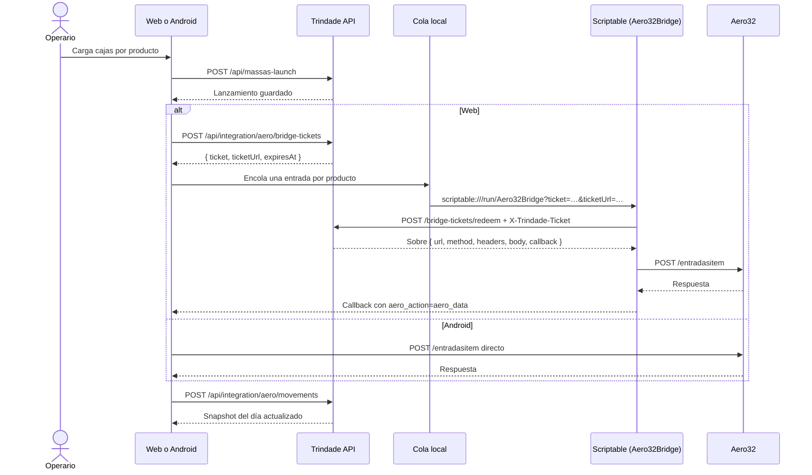

# Integración Aero32 — Lanzamiento de Masas y espejo del ERP

Esta guía describe la integración operativa entre Trindade y el ERP **Aero32**: cómo se configura, cómo viaja un
lanzamiento desde la web o Android hasta el WebService de la fábrica, cómo se guarda el espejo del día y qué
reglas se aplican al importar un asiento. Los contratos exactos de los endpoints están en
[registro-integracion-aero-webservice.md](registro-integracion-aero-webservice.md); la auditoría del ERP, en
[integracion-aero32.md](integracion-aero32.md).

## 1. Alcance y principios

- La integración está disponible para **Administrador y Trabalhador**. Cada operador autenticado tiene su propio
  cofre: guarda su usuario y contraseña del ERP sin ver los del resto. La dirección de la planta sigue siendo un
  campo exclusivo de `wilkin`; las credenciales pertenecen a quien tiene el teléfono. La autoridad es la base de
  datos, no el cuerpo de la petición ni el estado del navegador.
- **La contraseña del ERP vive en el servidor.** Se escribe una vez en el panel, se guarda cifrada con
  AES-256-GCM en `aero_integration_settings` y no vuelve nunca al navegador. La web recibe un ticket de un solo
  uso y el script de Scriptable lo canjea por el sobre del pedido. Cerrar sesión no borra el cofre: solo **Limpiar**
  lo elimina.
- **Trindade guarda primero.** El lanzamiento se persiste en Trindade antes de intentar el ERP. Si la empresa no
  responde, la producción no se pierde.
- **La empresa manda en lo que ya registró.** Un asiento del ERP es de solo lectura en Trindade. Importarlo crea un
  lanzamiento local nuevo, nunca modifica el asiento de la empresa.
- **La identidad del asiento se conserva.** El operario es el que el ERP registró, no quien importa.
- **El espejo es de la planta.** El snapshot del día se guarda en Trindade y lo puede leer cualquier operario
  autenticado; es una copia de lo que la empresa ya registró.

## 2. Por qué la web usa Scriptable y Android no

La web corre en `https://trindademasas.duckdns.org`. El WebService de la fábrica escucha en HTTP plano sobre la red
interna (`http://192.168.25.250:1453/api`). Safari bloquea ese salto por dos capas: *mixed content* (contenido
inseguro dentro de una página segura) y *Private Network Access* (una página pública no puede alcanzar direcciones
privadas). No es un error de configuración que se arregle con cabeceras: es una negativa del navegador antes de
emitir el paquete.

Scriptable corre como proceso nativo en el iPhone, sin origen de página. Puede hablar HTTP plano contra la IP
interna cuando el teléfono está en el Wi-Fi de la fábrica. Por eso la web delega el `POST` en el script y recibe la
respuesta por un callback. Lo que la página le entrega al script es un **ticket de un solo uso**, no la credencial:
el sobre con el `Authorization: Basic` lo arma el servidor, que es el único que puede descifrar la contraseña
guardada.

Android no tiene ese problema: la app corre en la red de la planta y llama al WebService directamente, con
`OkHttp` y Basic Auth leída del almacén cifrado. La configuración release solo permite HTTP hacia
`192.168.25.250`; el resto del tráfico exige HTTPS.

## 3. Flujo completo



`/entradasitem` acepta **un producto por petición** (o hasta ocho en el sobre de lote). Un lanzamiento de tres
productos son tres idas y vueltas. La cola en `localStorage` evita que la segunda se pierda si iOS abre la vuelta en
otra pestaña.

Cada entrada de la cola lleva **su operario**. `ENT_USU` es la persona que cargó las cajas, no la que configuró el
teléfono: el lanzamiento pendiente de Jaime sale como `JAIME` aunque el navegador esté configurado con el usuario de
Wilkin. Una entrada sin operario, de una cola vieja, firma con el usuario configurado como respaldo.

El botón **Enviar ao ERP** de una fila pendiente y el interruptor de sincronización al lanzar son dos caminos
distintos: el botón de la fila arma una cola con ese producto, sus unidades, sus lanzamientos y su operario, y
dispara `entradasitem` (`launch_sync`); el botón **Sincronizar com ERP** de la cabecera consulta `movimentoitem`
(`read_history`) y no escribe nada en la empresa.

### 3.1 La lectura que el lanzamiento deja debiendo

Conciliar no es enviar: es leer. Cuando el ERP confirma un lanzamiento, la fila todavía no puede saberse
conciliada, porque la única prueba de que la empresa lo tiene es el asiento en `/movimentoitem`. Hasta esta
versión ese segundo viaje lo hacía el operario a mano, con **Sincronizar com ERP**, cuando se acordaba.

Ahora lo dispara el propio lanzamiento, sin pedirle nada:

1. El envío vuelve y la cola del día queda **vacía**: no hay nada más que mandar.
2. La página muestra el **veredicto** y lo deja leer. Todavía no viaja: la lectura no puede tapar la respuesta
   que el operario está esperando.
3. Al cerrar el veredicto — el `onClose` del diálogo o el botón **Fechar**, el mismo cierre — la página gasta
   la marca del día y dispara el viaje de `movimentos` con el mismo sobre de siempre.
4. La vuelta guarda el día completo en `POST /api/integration/aero/movements` y la tabla se reconcilia sola: la
   fila del lote pasa de **pendiente** a **conciliada** por fecha + producto + unidades + operario.

Guardas, todas verificadas en pruebas:

- Sólo el **día abierto** (hoy). Un día pasado no se lee ni se reescribe.
- Sólo con las **credenciales completas**; sin contraseña la página lo dice en vez de fallar en silencio.
- Sólo si **algo se envió**: un lote rechazado entero no deja lectura pendiente.
- Un **lote parcial** no arma la lectura: lo que falló sigue en la cola y su reintento arma su propio veredicto.
- **Una lectura a la vez.** Si el botón está leyendo, el camino automático no abre otra.
- Un **viaje que no vuelve** (el operario cierra Scriptable sin ejecutar) no se reintenta solo; el botón sigue ahí.

Si la lectura falla, el veredicto del envío queda intacto, la fila sigue pendiente y el motivo se ve en el
aviso. La lectura nunca deshace un lanzamiento.

En la bitácora del servidor cada lectura deja su par `read_history` `requested`/`result` con el mismo
`attemptId` y la fecha en `note`, igual que el botón. Es la forma de distinguir «el operario leyó» de «la
lectura automática no llegó».

Lo que el espejo guarda es **todo** lo que el ERP devolvió ese día, insumos incluidos. La clasificación es una
sola regla por código, `isMassa(code)` en `packages/backend/src/modules/stock/stock.catalog.ts`: **los diez
códigos de masa** (`1045, 39, 60, 84, 91, 1192, 5000, 1047, 22, 1616`) son producción; **cualquier otro código es
insumo**, aunque su descripción empiece con «MASSA P PIZZA». La descripción no decide nunca. Masas muestra esos
diez; los insumos son de **Insumos** (Recebimento) y **Relatório**. Ocultarlos en una tabla no es filtrarlos en la
base: el espejo se guarda completo y se clasifica al leer.

## 3.1 El mensaje de WhatsApp del día

El botón **Compartilhar** de Lançamento de Massas arma el mensaje desde las **filas unificadas**, no desde
`launches`: los lanzamientos locales y los asientos del espejo, deduplicados por asiento (`ent_lan`) y por
lanzamiento. Por eso un trabajador que sólo existe en el ERP —la tableta lo registró y Trindade no lo lanzó—
aparece en el mensaje con su nombre marcado «(só ERP)», sus productos y sus cajas. La lista se filtra por los diez
códigos del catálogo, así que un insumo nunca entra aunque su descripción diga «MASSA». Web y Android generan el
mismo texto para el mismo día.

## 4. Configuración en la web

Dentro de **Lanzamiento de Masas**, debajo de la grilla, hay una tarjeta colapsable. Arranca abierta solo cuando
todavía no hay nada configurado. El panel pide **tres datos**:

| Campo | Qué es | Dónde se guarda | Validación |
| --- | --- | --- | --- |
| URL del WebService | Base del WebService, por ejemplo `http://192.168.25.250:1453/api` | Servidor (cofre) | Debe empezar con `http://` o `https://` y tener host; máximo 2048 caracteres |
| Usuario de la empresa | Usuario del WebService | Servidor (cofre) | No vacío; máximo 64 caracteres |
| Contraseña de la empresa | Contraseña del WebService | Servidor, **cifrada** | No vacía la primera vez; una vacía conserva la guardada |

No hay campo de código de usuario: `ENT_USU` viaja con el **usuario en mayúsculas**, que es lo que manda el binario
Delphi de `base.apk`. El `CODIGO` numérico que devuelve el ERP no se pide ni se guarda.

Datos que resuelve el sistema:

| Dato | Cómo se obtiene |
| --- | --- |
| Usuario del asiento (`ENT_USU`) | El usuario del panel, en mayúsculas |
| Cantidad (`PRO_QTD`) | Siempre en unidades: `cajas × unidades por caja` |
| Serie del asiento (`ENT_SER`, `PED_SER`) | Fija en `APL`, la que trae el binario Delphi |
| Situación tributaria (`PRO_CST`) | `000` (tributada integralmente de fabricación propia) |

El servidor es la autoridad de la configuración. El panel lee `GET /api/integration/aero/settings` al montar y
muestra **Configurado** cuando `hasPassword` es verdadero. El campo de contraseña arranca **siempre vacío**: nunca se
rellena desde el servidor, porque el servidor nunca la devuelve ni la devolverá. La frase **«Senha guardada no
servidor»** es la confirmación de que está ahí.

- Guardar con la contraseña **vacía** conserva la existente: se puede cambiar URL o usuario sin reescribir el
  secreto. Si no hay contraseña previa y no viene una nueva, el servidor responde `400` con un código accionable
  (`AERO_VAULT_PASSWORD_REQUIRED`).
- Guardar con una contraseña **nueva** la reemplaza, cifrada de nuevo.
- **Limpiar** llama `DELETE /api/integration/aero/settings` y solo entonces limpia el estado local; si falla, la
  pantalla no miente. Ese borrado elimina también los tickets pendientes de ese operador.
- En `localStorage` quedan solo preferencias no secretas: el interruptor de sincronización y la fecha de la última
  sincronización. La URL y el usuario vienen del servidor. El nombre del script no es una preferencia: es una
  constante de integración (`Aero32Bridge`) que el deep link usa tal cual.

**La contraseña nunca vuelve al navegador.** Ninguna respuesta del API devuelve la contraseña, el ciphertext, el IV
ni el tag; tampoco se escribe en `localStorage`, en `sessionStorage`, en una cookie, en la bitácora, en un log ni en
una URL. Lo que la web puede pedir es un **ticket**: 32 bytes aleatorios con 120 s de vida, un solo uso, del que la
base guarda solo el SHA-256. Scriptable canjea el ticket por el sobre ya armado.

Consecuencia práctica: una pestaña nueva —el callback de Scriptable, una pestaña duplicada, otro dispositivo del
misma cuenta— consulta, lanza y lee **sin volver a pedir la contraseña**. El cofre no se borra al cerrar sesión; solo
**Limpiar** lo elimina.

Debajo de los campos, el panel ofrece el camino del teléfono: **Instalar Scriptable no iPhone** abre la App Store,
**Copiar código para Scriptable** deja el JavaScript del puente en el portapapeles y un tercer botón abre el mismo
diálogo con los pasos y con «Abrir Scriptable». El puente se instala **una sola vez por teléfono** y no se descarga
ningún archivo: el detalle está en la §6.1.

## 5. Prueba de conexión

La prueba hace `POST {URL}/usuarios` con Basic Auth y traduce el resultado a una frase útil. La ruta no lleva barra
final: la barra provocaba un `301` que convertía el `POST` en `GET` y devolvía `405`.

El panel no puede armar ese `POST`: no tiene la contraseña ni la alcanza la red de la fábrica. Por eso **Probar
conexión** pide un ticket de acción `test`; el servidor lo mapea a `/usuarios` y arma el sobre con el
`Authorization: Basic` descifrado en memoria, y Scriptable hace el `POST` como en cualquier lanzamiento.

| Veredicto | Significado |
| --- | --- |
| `success = true` | La empresa respondió y aceptó las credenciales |
| `success = false` | El endpoint respondió y rechazó el login (`401`) |
| Sin veredicto | El operario volvió sin ejecutar el script, el script se cortó o el ticket venció a los 120 s |

Cada intento se registra en la bitácora del backend en dos líneas: `requested` antes de que el teléfono salga y
`result` cuando vuelve. Una línea `requested` sin `result` significa que el pedido nunca salió del teléfono. Ni el
ticket ni la contraseña aparecen en esas líneas: el ticket viaja solo en el header `X-Trindade-Ticket` del canje.

Si el cofre todavía no tiene contraseña, el panel lo dice con una frase accionable
(`AERO_VAULT_NOT_CONFIGURED` la primera vez) en vez de fallar en silencio.

## 6. Scriptable `Aero32Bridge`

Scriptable es la app de iPhone que ejecuta JavaScript como proceso nativo. El script `Aero32Bridge` no sabe de masas
ni de stock: recibe un **ticket**, lo canjea por un sobre, hace el `POST` contra el ERP y devuelve la respuesta por
el callback.

La web sigue pidiendo el ticket con `POST /api/integration/aero/bridge-tickets` **exactamente como antes**. Lo único
que cambió es el enlace profundo que abre el proceso nativo: ya no es `shortcuts://` sino

```text
scriptable:///run/Aero32Bridge?ticket=<token>&ticketUrl=<url codificada>
```

`ticket` y `ticketUrl` viajan codificados con `encodeURIComponent`. El nombre `Aero32Bridge` es una constante de
integración: el deep link lo necesita tal cual y no se configura en el panel.

### 6.1 Instalación por copia de código

Una sola vez por teléfono. No hay archivo que descargar ni importar: la página sirve el JavaScript crudo del puente
en `/Aero32Bridge.js` y el operador lo pega en Scriptable.

1. Instalar **Scriptable** desde el App Store: <https://apps.apple.com/app/scriptable/id1405459188>. El botón
   **Instalar Scriptable no iPhone** del panel abre esa misma ficha.
2. Tocar **Copiar código para Scriptable** en el panel o en el diálogo. La página copia el contenido de
   `/Aero32Bridge.js`, que es JavaScript crudo: la fuente es `packages/frontend/scriptable/Aero32Bridge.js` y
   `scripts/build-scriptable.mjs` publica una copia idéntica en `packages/frontend/public/Aero32Bridge.js`, que
   Vite copia al build.
3. Abrir Scriptable, tocar **+** y pegar el código en el editor del script nuevo.
4. Renombrar el script a **`Aero32Bridge`**. Ese nombre es la constante que usa el deep link y no se configura en
   el panel.
5. Volver a Trindade. Desde ahí, los botones del módulo abren Scriptable directamente.

**Por qué no se descarga el `.scriptable`.** Ese archivo es un JSON —`{"name": …, "script": …}`— y al pegarlo en el
editor de Scriptable se ejecuta el objeto entero: el parser muere en el primer `:` de `"name"` con
`SyntaxError: Unexpected token ':'`. Lo que Scriptable corre es el texto de adentro de `script`, no el envoltorio, y
por eso el camino correcto es copiar el código. El `.scriptable` sigue existiendo en `/Aero32Bridge.scriptable` como
artefacto interno del build, pero ninguna pantalla ofrece su descarga ni su importación; el paso
**Compartir → Scriptable** fue retirado.

Tampoco hay receta de acciones, botones para copiar valores sueltos ni enlace de iCloud: el puente es un script y se
instala como cualquier script de Scriptable.

### 6.2 Canje del ticket

El script lee `args.queryParameters.ticket` y `args.queryParameters.ticketUrl`. Si falta alguno, muestra un aviso
breve y termina sin inventar un callback. Con ambos, hace `POST` a `ticketUrl` con `X-Trindade-Ticket: <ticket>`,
`Accept: application/json`, **sin cuerpo**, `allowInsecureRequest = true` y un `timeoutInterval` explícito (8–10 s).
Si el canje no llega —sin internet, por ejemplo— muestra un `Alert` corto y termina: no hay callback que inventar.

El sobre que devuelve el canje es el mismo de siempre, armado por el servidor y con `body` y `bodies` como **texto
JSON**:

```json
{
  "url": "http://192.168.25.250:1453/api/entradasitem",
  "method": "POST",
  "headers": { "Authorization": "Basic …", "Content-Type": "application/json", "Accept": "application/json" },
  "body": "{\"PRO_COD\":\"001192\",\"PRO_DES\":\"MASSA QUADRADA\",\"PRO_QTD\":1500,\"PRO_CST\":\"000\",\"ENT_DTA\":\"2026-10-28\",\"ENT_USU\":\"WILKIN\",\"ENT_SER\":\"APL\",\"ENT_OBS\":\"\"}",
  "callback": "https://trindademasas.duckdns.org/massas-launch?aero_action=entrada&aero_data="
}
```

| Clave del sobre | Qué es | Qué hace el script con ella |
| --- | --- | --- |
| `url` | Endpoint completo del ERP | Destino del `POST` al WebService |
| `method` | Siempre `POST` | Método del pedido |
| `headers` | `Authorization: Basic …`, `Content-Type` y `Accept` | Encabezados del pedido, tal como llegan |
| `body` | JSON del pedido serializado como texto | Cuerpo cuando hay un solo payload |
| `bodies` | Lista de textos JSON, solo en el lote | Un pedido por elemento |
| `callback` | Vuelta a la página, con la acción ya puesta | URL que se abre al final |

### 6.3 Envío y retorno

1. Si el sobre trae `bodies` como lista no vacía, el script recorre esos elementos; si no, usa `[body]`.
2. Cada payload se envía como texto JSON a `url` con los `headers` del sobre y `allowInsecureRequest = true`,
   porque el WebService es HTTP plano en la LAN.
3. Un payload devuelve el texto tal cual; un lote devuelve `[respuesta1,respuesta2,…]`, con coma entre respuestas y
   corchetes alrededor, que es exactamente lo que la página ya sabe leer.
4. Al final abre `callback + encodeURIComponent(resultado)` en Safari y termina la ejecución del script.

Cada `POST` al ERP lleva su propio `timeoutInterval` (8–10 s). Sin timeout propio, una red que no responde deja la
pantalla «enviando» el tiempo que iOS decida, y un lote de ocho payloads espera ese plazo ocho veces.

Detalles que importan:

- **El `body` del sobre va como texto, no como diccionario.** Si el script lo tratara como objeto, terminaría
  enviando una lista de propiedades en vez de JSON y el ERP recibiría algo que no puede leer.
- **La contraseña del ERP no cambia ni viaja al iPhone.** Sigue cifrada en el cofre del servidor, y el teléfono
  nunca la recibe: el script entrega el ticket y el servidor devuelve el sobre con el `Authorization` ya armado.
  Cambiar la contraseña en el panel no obliga a volver a tocar el iPhone.
- **El ticket se canjea en el header, no en la URL del pedido.** El deep link lleva el ticket a la app local, pero
  el `POST` de canje lo manda en `X-Trindade-Ticket`: así no queda en los logs del proxy ni en una captura de red.
- **El script no registra ni muestra secretos.** No escribe `Authorization`, el ticket ni ninguna contraseña en
  pantalla, en un archivo ni en un log, y no guarda estado entre ejecuciones.
- **La respuesta vuelve por el callback.** La página separa el prefijo, decodifica y lee el cuerpo real. La acción
  viaja en `aero_action`: `entrada`, `saida`, `movimentos` o `test`. Los parámetros se leen y se borran de la URL
  con `replaceState`, así que un *pull-to-refresh* no vuelve a procesar el mismo resultado.

### 6.4 Cuando el ERP no responde

**El SSID no se puede leer.** iOS entrega el nombre de la red Wi-Fi solo a apps nativas con permiso de ubicación
precisa y el entitlement de Wi-Fi; Safari y Scriptable no exponen esa API. Por eso la app **no comprueba** que el
teléfono esté en «Trindade Expedicao»: comprueba si el **host del ERP responde**. Si no responde, el mensaje dice
que el iPhone puede no estar en la red de la empresa **o** que el ERP puede no estar disponible, que es lo único que
se puede afirmar desde el teléfono.

En el script:

- Un fallo de **red o timeout en el primer `POST`** al ERP corta el lote: no tiene sentido esperar 8 × 10 s por los
  demás payloads. Devuelve un callback de error explícito sobre `callback` y termina:

  ```text
  …&aero_error=wifi_required&aero_msg=<mensaje codificado>
  ```

- Una **respuesta HTTP** del ERP —incluido un `4xx` o un `5xx`— no es un error de red: el ERP contestó y su
  respuesta vuelve por el callback como siempre.
- `wifi_required` es un código estable. La web traduce el mensaje y el `aero_msg` queda como texto de respaldo.

En la web:

- El callback se parsea **antes** que `aero_action`: un `aero_error` nunca se interpreta como un puente válido. El
  mensaje se muestra al operario con la frase de Wi-Fi/ERP, se limpia la query con `replaceState` y se borra el
  intento pendiente para que un *refresh* no lo repita.
- **La cola y los lanzamientos pendientes se conservan**; nada se marca como enviado y el **espejo no se actualiza**.
  Un fallo de red no es un lanzamiento fallido ni un día vacío.
- El botón de prueba de conexión vuelve a quedar habilitado: el error de red no se trata como credencial inválida.
- **Watchdog.** Antes de abrir Scriptable se guarda una marca local `{ action, date, at }`. Se limpia al recibir
  cualquier callback. Al volver a la pantalla, si la marca supera unos **150 s**, se muestra «Scriptable no volvió;
  revisá la Wi-Fi de la empresa y reintentá», se resetea el estado de envío y la marca se borra. Una vuelta rápida no
  dispara el aviso.
- **Sin internet en el navegador.** Si `navigator.onLine === false`, la app muestra «Sin conexión a internet» y **no
  abre** Scriptable: sin red el canje del ticket no puede funcionar.

## 7. Contratos del WebService

Cabeceras en todas las llamadas:

```http
Authorization: Basic base64(usuario:senha)
Accept: application/json
Content-Type: application/json
```

| Endpoint | Método | Uso |
| --- | --- | --- |
| `/usuarios` | `POST` | Prueba de credenciales y obtención del `CODIGO` |
| `/entradasitem` | `POST` | Entrada de producción (lanzamiento de masas) |
| `/saidasitem` | `POST` | Baja de insumos, embalagens e bobinas desde el módulo Salida / Baixa |
| `/movimentoitem` | `POST` | Consulta de movimientos por usuario, producto y rango de fechas |

Reglas de payload:

- `PRO_COD` va a **6 dígitos con ceros a la izquierda**.
- `PRO_QTD` se escala **×100** en el pedido para que Firebird no lo grabe como decimal; la respuesta de
  `/movimentoitem` vuelve en unidades humanas, no escalada.
- `ENT_USU` y `PED_USU` van en mayúsculas.
- `ENT_SER` y `PED_SER` van fijos en `APL`.
- Las fechas van en `YYYY-MM-DD` y en la zona de São Paulo.

Los JSON completos, los campos de `/saidasitem` y el mapeo de `/movimentoitem` están en
[registro-integracion-aero-webservice.md](registro-integracion-aero-webservice.md).

## 8. Espejo del día y conciliación

El script corre en un solo teléfono, pero el espejo lo lee toda la planta. La respuesta del ERP se guarda como
snapshot del día en `aero_movements` para que cualquier dispositivo la vea sin volver a ejecutar el script.

- `POST /api/integration/aero/movements` — cuerpo `{ date, movements }`, un elemento por asiento con `ent_lan`,
  `product_code`, `product_desc`, `quantity`, `entry_date`, `operator_name` y `movement_type` (`"E"` o `"S"`).
  Responde `201 { saved }`. Un cuerpo inválido se rechaza con `400 INVALID_MOVEMENTS` y no escribe nada.
- `GET /api/integration/aero/movements?date=YYYY-MM-DD` — responde `{ date, movements }` ordenado por `ent_lan`.
  Cualquier operario autenticado puede leerlo.
- La clave única es `(movement_date, ent_lan, product_code)`: una segunda sincronización del mismo día actualiza
  los asientos que reconoce en lugar de duplicarlos. Los asientos que la respuesta ya no menciona **no** se borran.
- `operator_name` se normaliza a mayúsculas al guardar.
- La tabla es la revisión **7** del esquema y se migra explícitamente; contra una base sin migrar los endpoints
  responden `503 AERO_MOVEMENTS_NOT_MIGRATED`.
- `synced_at` es cuándo Trindade supo del ERP, no cuándo ocurrió el movimiento.

**Un lanzamiento conciliado no se toca.** Cuando el asiento del ERP y el lanzamiento local describen la misma
producción —misma fecha, código, cantidad y operario—, la fila queda conciliada y deja de ofrecer editar y
eliminar, para cualquier rol. No es una restricción de permisos sino de consistencia: Delphi ya asentó esa entrada.
El backend rechaza `PUT` y `DELETE` aunque se los pida por fuera de la interfaz.

**Las salidas tienen su propia conciliación.** El módulo Salida / Baixa escribe por `/saidasitem` con prefijo
`PED_*` y reconcilia contra los asientos `ENTSAI: "S"` del espejo: misma fecha de planta, mismo código sin ceros,
misma cantidad y mismo operador (username o nombre visible), consumiendo cada asiento una sola vez. Un movimiento
queda `reconciled` con todos sus ítems conciliados, `partial` con algunos y `pending` sin ninguno; los asientos
`E` nunca concilian una salida. `Conferir no ERP` es la lectura que llena ese espejo, y el movimiento local no se
edita ni se borra aunque el ERP lo confirme.

**La importación conserva la identidad del asiento.** `POST /api/massas-launch` acepta `ent_lan`, y el operario
viaja **por ítem** en `items[].operator_name`: un lote de la tableta puede ser el trabajo de dos personas, y el
dueño de cada fila es quien la escribió. El lanzamiento guarda el asiento en `massa_launches.ent_lan` y el
operario como dueño cuando ese nombre resuelve a un usuario activo. La forma vieja, un `operator_name` en el
cuerpo para todo el lote, se sigue aceptando: es el respaldo de los clientes que todavía no se actualizaron, y un
ítem que no nombra a nadie hereda el del cuerpo. La conciliación empareja primero por `ent_lan`, sin mirar el
nombre. Un asiento ya importado se rechaza con `409 MASSAS_ALREADY_IMPORTED`.

**Importar es de quien es el asiento.** El backend resuelve el dueño en `aero_movements`, no en el cuerpo de la
petición, y responde `403 MASSAS_FORBIDDEN` cuando un trabajador intenta importar el asiento de otro operario. Un
administrador puede importar el asiento de cualquier operario que exista en Trindade.

**Nadie hereda un asiento que no puede atribuir.** Si el nombre del asiento no resuelve a ningún usuario, el
import se rechaza con `409 MASSAS_OPERATOR_NOT_LINKED`, también para un administrador. Si resuelve a una cuenta
desactivada, el rechazo es `409 MASSAS_OPERATOR_INACTIVE`. La pantalla ofrece `+ Crear Operario` en lugar de
`Importar` para esas filas.

## 9. Errores y mensajes

Toda negativa del módulo de masas viaja con dos campos y en portugués: `code` es el hecho y `error` es la frase que
el operario puede leer. El código decide antes que la frase, porque una frase se reescribe y un código no.

| `code` | HTTP | Lo que dice la pantalla |
| --- | --- | --- |
| `MASSAS_HISTORY_FROZEN` | 409 | El histórico de masas es de solo lectura: los días pasados no se pueden alterar |
| `MASSAS_FORBIDDEN` | 403 | Este lanzamiento pertenece a otro operario |
| `MASSAS_ALREADY_IMPORTED` | 409 | Este lanzamiento del ERP ya fue importado |
| `MASSAS_RECONCILED` | 409 | Esta producción ya fue conciliada con el ERP y no se puede alterar |
| `MASSAS_OPERATOR_NOT_LINKED` | 409 | El asiento no tiene un operario vinculado en Trindade |
| `MASSAS_OPERATOR_INACTIVE` | 409 | El operario del asiento está desactivado |
| `MASSAS_FUTURE_DATE` | 400 | No se puede lanzar en fechas futuras |
| `MASSAS_NOT_FOUND` | 404 | Lanzamiento no encontrado |
| `MASSAS_INVALID_BOXES` | 400 | Cantidad de cajas inválida |
| `MASSAS_CREATE_FAILED`, `…_UPDATE_FAILED`, `…_DELETE_FAILED` | 400 | No se pudo registrar, actualizar o eliminar |

El resto de los códigos (`MASSAS_INVALID_DATE_FORMAT`, `MASSAS_INVALID_LAUNCH_DATA`, `MASSAS_EMPTY_ITEMS`,
`MASSAS_INVALID_ID`) siguen la misma regla y tienen su frase en la tabla de i18n de la web.

El cofre y los tickets usan su propia familia, con la misma forma (`code` + frase accionable):

| `code` | HTTP | Cuándo |
| --- | --- | --- |
| `AERO_VAULT_NOT_CONFIGURED` | 503 | Falta `AERO_VAULT_KEY` o no hay contraseña usable guardada |
| `AERO_VAULT_INVALID_SETTINGS` | 400 | URL sin `http://`/`https://` o sin host, o usuario vacío |
| `AERO_VAULT_PASSWORD_REQUIRED` | 400 | Primera vez, sin contraseña previa y sin una nueva |
| `AERO_BRIDGE_INVALID_ACTION` | 400 | Acción fuera de `entrada`, `entrada_lote`, `movimentos`, `test` |
| `AERO_BRIDGE_INVALID_PAYLOADS` | 400 | Cantidad o tamaño de payloads fuera de rango |
| `AERO_BRIDGE_INVALID_CALLBACK` | 400 | El callback no comparte origen con `PUBLIC_APP_URL` |
| `AERO_TICKET_MISSING` | 401 | Falta `X-Trindade-Ticket` en el canje |
| `AERO_TICKET_NOT_FOUND` | 404 | El hash del ticket no existe |
| `AERO_TICKET_UNUSABLE` | 410 | Ticket ya usado o vencido; la respuesta no distingue cuál de los dos fue |

## 10. Procedimiento de prueba en fábrica

Antes de ir:

- [ ] `docker compose ps` con `api` y `web` sanos, y `https://trindademasas.duckdns.org` respondiendo 200.
- [ ] El iPhone tiene **Scriptable** instalado y el script `Aero32Bridge` creado una sola vez: **Copiar código para
      Scriptable** en el panel, abrir Scriptable, **+**, pegar, renombrar a `Aero32Bridge` y volver. No hay archivo que
      descargar ni importar, ni receta de acciones que mantener.
- [ ] El iPhone está en el Wi-Fi de la fábrica; el script no funciona por datos móviles porque la IP es interna. La
      app no puede leer el SSID: la prueba es que el host del ERP responda.

En la fábrica:

1. Abrir la web en Safari e iniciar sesión con la cuenta del operador (`wilkin` para administrar la dirección; cualquier trabajador para sus propias credenciales).
2. **Lanzamiento de Masas → Configuración Integración Empresa**: URL y usuario; la contraseña se escribe una sola
   vez y queda cifrada en el servidor. El campo vuelve a aparecer vacío y la tarjeta dice «Senha guardada no
   servidor».
3. **Probar conexión**. El botón pide un ticket `test` y abre Scriptable con
   `scriptable:///run/Aero32Bridge?ticket=…&ticketUrl=…`, que canjea el ticket por el sobre de `/usuarios`; al
   volver, la tarjeta dice si la empresa respondió. Lo que importa es que no quede en «sin veredicto».
4. Cargar **un** producto, una caja, y confirmar con el interruptor **Sincronizar con ERP** activo.
5. iOS abre Scriptable con el script `Aero32Bridge`; al volver, la tarjeta de confirmación debe desaparecer y
   aparecer el resultado.
6. Cerrar el veredicto y esperar el segundo viaje: iOS vuelve a abrir el script para `movimentos`, la página guarda
   el día y la fila pasa a **conciliada** sin tocar **Sincronizar com ERP**. En el log quedan dos pares:
   `launch_sync` del envío y `read_history` de la lectura.
7. Verificar en el ERP que la entrada existe y en el log del servidor las dos líneas (`requested` y `result`).
8. Repetir con dos productos para comprobar que la cola envía el segundo después del retorno del primero.
9. Probar el fallo: apagar el Wi-Fi, lanzar y confirmar que el lanzamiento **igual** quedó guardado en Trindade y
   que la página avisa de la Wi-Fi/ERP sin borrar la cola.
10. Probar el retorno que no llega: abrir Scriptable al pedir el ticket y no ejecutar el script. A los ~150 s, al
    volver a la página, el aviso dice que Scriptable no volvió y el estado de envío queda libre.

## 11. Límites conocidos

- El script necesita el teléfono en la red de la fábrica; no hay acceso remoto al WebService.
- **El SSID no se comprueba.** Safari y Scriptable no pueden leer el nombre de la red Wi-Fi; lo que se mide es si el
  host del ERP responde. Si no responde, el aviso dice que el iPhone puede no estar en la red de la empresa o que el
  ERP puede no estar disponible, sin afirmar cuál de las dos cosas pasó.
- Si el canje del ticket falla por falta de internet, el script no inventa un callback: muestra un `Alert` corto y
  termina. La web lo cubre con el watchdog, no con un veredicto del ERP.
- Sin retorno del script (el operario lo cierra sin ejecutar), la página no puede adivinar el resultado: el watchdog
  avisa a los ~150 s y deja reintentar.
- La URL, el usuario y la contraseña viven en el servidor, una vez por instalación. El interruptor de
  sincronización y la fecha de la última sincronización siguen siendo preferencias del dispositivo; el nombre del
  script no, porque es una constante de integración.
- El ticket vive **120 s** y sirve una sola vez. Si el teléfono tarda en volver o el operario repite el canje, el
  API responde `410` y la página pide un ticket nuevo; el lanzamiento ya está guardado en Trindade y no se pierde.
- La prueba de conexión ya no sale del navegador: pide un ticket `test` y va por Scriptable, igual que un lanzamiento.
- La respuesta vuelve por la URL del callback: un rango de movimientos muy grande puede superar lo que iOS está
  dispuesto a abrir. Es un motivo más para no pedir historiales largos desde el teléfono.
- El `Authorization: Basic` sigue viajando al ERP porque el ERP no ofrece otro mecanismo, y el script de Scriptable
  es el único proceso que habla con la red de la fábrica. Lo que se eliminó es la contraseña del navegador, no el
  Basic Auth del pedido.
- La integración no escribe en las tablas fiscales del ERP ni reemplaza la operación de la empresa.

## 12. Estado de las piezas

| Pieza | Estado |
| --- | --- |
| Cofre cifrado del ERP en el servidor (AES-256-GCM) | Implementada |
| Ticket de un solo uso para el puente Scriptable | Implementada |
| Prueba de conexión `/usuarios` | Implementada por ticket `test` |
| Lanzamiento de masas `/entradasitem` | Implementada |
| Espejo `/movimentoitem` | Implementada |
| Reporte del día desde el ERP | Implementada |
| Importación de asiento y conciliación | Implementada |
| Alta de operario desde el asiento | Implementada |
| Bajas de stock `/saidasitem` | Contrato listo; interfaz pendiente |
| Escritura directa en Firebird | Descartada; se usa el WebService |

## 13. Referencias

- [registro-integracion-aero-webservice.md](registro-integracion-aero-webservice.md) — contratos JSON completos.
- [integracion-aero32.md](integracion-aero32.md) — auditoría del ERP y alternativas.
- [calculadoras.md](calculadoras.md) — reglas de masas y stock.
- [arquitectura.md](arquitectura.md) — mapa técnico del sistema.
