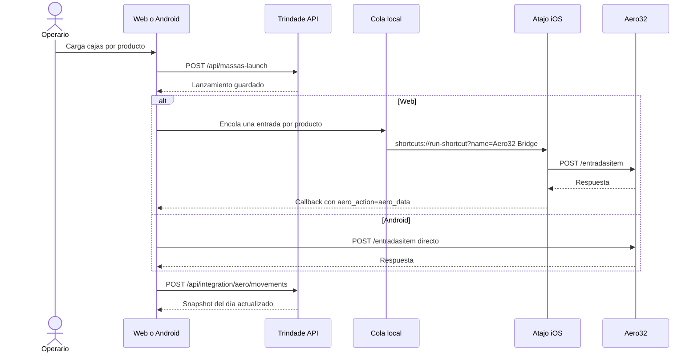

# Integración Aero32 — Lanzamiento de Masas y espejo del ERP

Esta guía describe la integración operativa entre Trindade y el ERP **Aero32**: cómo se configura, cómo viaja un
lanzamiento desde la web o Android hasta el WebService de la fábrica, cómo se guarda el espejo del día y qué
reglas se aplican al importar un asiento. Los contratos exactos de los endpoints están en
[registro-integracion-aero-webservice.md](registro-integracion-aero-webservice.md); la auditoría del ERP, en
[integracion-aero32.md](integracion-aero32.md).

## 1. Alcance y principios

- La integración es **exclusiva del usuario `wilkin` con rol Administrador**. Para cualquier otro usuario el panel
  no se renderiza, el interruptor no aparece y el backend rechaza la bitácora con `403`. La autoridad es la base
  de datos, no el cuerpo de la petición ni el estado del navegador.
- **Trindade guarda primero.** El lanzamiento se persiste en Trindade antes de intentar el ERP. Si la empresa no
  responde, la producción no se pierde.
- **La empresa manda en lo que ya registró.** Un asiento del ERP es de solo lectura en Trindade. Importarlo crea un
  lanzamiento local nuevo, nunca modifica el asiento de la empresa.
- **La identidad del asiento se conserva.** El operario es el que el ERP registró, no quien importa.
- **El espejo es de la planta.** El snapshot del día se guarda en Trindade y lo puede leer cualquier operario
  autenticado; es una copia de lo que la empresa ya registró.

## 2. Por qué la web usa un atajo y Android no

La web corre en `https://trindademasas.duckdns.org`. El WebService de la fábrica escucha en HTTP plano sobre la red
interna (`http://192.168.25.250:1453/api`). Safari bloquea ese salto por dos capas: *mixed content* (contenido
inseguro dentro de una página segura) y *Private Network Access* (una página pública no puede alcanzar direcciones
privadas). No es un error de configuración que se arregle con cabeceras: es una negativa del navegador antes de
emitir el paquete.

Un atajo de iOS corre como proceso nativo, sin origen de página. Puede hablar HTTP plano contra la IP interna
cuando el teléfono está en el Wi-Fi de la fábrica. Por eso la web delega el `POST` en el atajo y recibe la respuesta
por un callback.

Android no tiene ese problema: la app corre en la red de la planta y llama al WebService directamente, con
`OkHttp` y Basic Auth leída del almacén cifrado. La configuración release solo permite HTTP hacia
`192.168.25.250`; el resto del tráfico exige HTTPS.

## 3. Flujo completo



`/entradasitem` acepta **un producto por petición** (o hasta ocho en el sobre de lote). Un lanzamiento de tres
productos son tres idas y vueltas. La cola en `localStorage` evita que la segunda se pierda si iOS abre la vuelta en
otra pestaña.

Cada entrada de la cola lleva **su operario**. `ENT_USU` es la persona que cargó las cajas, no la que configuró el
teléfono: el lanzamiento pendiente de Jaime sale como `JAIME` aunque el navegador esté configurado con el usuario de
Wilkin. Una entrada sin operario, de una cola vieja, firma con el usuario configurado como respaldo.

El botón **Enviar ao ERP** de una fila pendiente y el interruptor de sincronización al lanzar son dos caminos
distintos: el botón de la fila arma una cola con ese producto, sus unidades, sus lanzamientos y su operario, y
dispara `entradasitem` (`launch_sync`); el botón **Sincronizar com ERP** de la cabecera consulta `movimentoitem`
(`read_history`) y no escribe nada en la empresa.

### 3.1 La lectura que el lanzamiento deja debiendo

Conciliar no es enviar: es leer. Cuando el ERP confirma un lanzamiento, la fila todavía no puede saberse
conciliada, porque la única prueba de que la empresa lo tiene es el asiento en `/movimentoitem`. Hasta esta
versión ese segundo viaje lo hacía el operario a mano, con **Sincronizar com ERP**, cuando se acordaba.

Ahora lo dispara el propio lanzamiento, sin pedirle nada:

1. El envío vuelve y la cola del día queda **vacía**: no hay nada más que mandar.
2. La página muestra el **veredicto** y lo deja leer. Todavía no viaja: la lectura no puede tapar la respuesta
   que el operario está esperando.
3. Al cerrar el veredicto — el `onClose` del diálogo o el botón **Fechar**, el mismo cierre — la página gasta
   la marca del día y dispara el viaje de `movimentos` con el mismo sobre de siempre.
4. La vuelta guarda el día completo en `POST /api/integration/aero/movements` y la tabla se reconcilia sola: la
   fila del lote pasa de **pendiente** a **conciliada** por fecha + producto + unidades + operario.

Guardas, todas verificadas en pruebas:

- Sólo el **día abierto** (hoy). Un día pasado no se lee ni se reescribe.
- Sólo con las **credenciales completas**; sin contraseña la página lo dice en vez de fallar en silencio.
- Sólo si **algo se envió**: un lote rechazado entero no deja lectura pendiente.
- Un **lote parcial** no arma la lectura: lo que falló sigue en la cola y su reintento arma su propio veredicto.
- **Una lectura a la vez.** Si el botón está leyendo, el camino automático no abre otra.
- Un **viaje que no vuelve** (el operario cancela el atajo) no se reintenta solo; el botón sigue ahí.

Si la lectura falla, el veredicto del envío queda intacto, la fila sigue pendiente y el motivo se ve en el
aviso. La lectura nunca deshace un lanzamiento.

En la bitácora del servidor cada lectura deja su par `read_history` `requested`/`result` con el mismo
`attemptId` y la fecha en `note`, igual que el botón. Es la forma de distinguir «el operario leyó» de «la
lectura automática no llegó».

Lo que el espejo guarda es **todo** lo que el ERP devolvió ese día, insumos incluidos. Masas sólo muestra el
catálogo de masas; los insumos son de **Recebimento** y **Relatório**. Ocultarlos en una tabla no es filtrarlos
en la base.

## 4. Configuración en la web

Dentro de **Lanzamiento de Masas**, debajo de la grilla, hay una tarjeta colapsable. Arranca abierta solo cuando
todavía no hay nada configurado. El panel pide **tres datos obligatorios**:

| Campo | Qué es | Validación |
| --- | --- | --- |
| URL del WebService | Base del WebService, por ejemplo `http://192.168.25.250:1453/api` | Debe empezar con `http://` o `https://`; se normaliza sin barra final duplicada |
| Usuario de la empresa | Usuario del WebService | No vacío |
| Contraseña de la empresa | Contraseña del WebService | No vacía; se muestra enmascarada |

No hay campo de código de usuario: `ENT_USU` viaja con el **usuario en mayúsculas**, que es lo que manda el binario
Delphi de `base.apk`. El `CODIGO` numérico que devuelve el ERP se muestra al probar la conexión y queda en la
bitácora, pero no se pide ni se guarda.

Datos que resuelve el sistema:

| Dato | Cómo se obtiene |
| --- | --- |
| Usuario del asiento (`ENT_USU`) | El usuario del panel, en mayúsculas |
| Cantidad (`PRO_QTD`) | Siempre en unidades: `cajas × unidades por caja` |
| Serie del asiento (`ENT_SER`, `PED_SER`) | Fija en `APL`, la que trae el binario Delphi |
| Situación tributaria (`PRO_CST`) | `000` (tributada integralmente de fabricación propia) |

Los ajustes viven en el `localStorage` de **ese** iPhone, no en el servidor. Hay que configurar una vez por
teléfono, y borrar los datos de Safari equivale a borrar la configuración. El botón **Limpiar** hace lo mismo de
forma explícita, con confirmación.

**La contraseña es la excepción.** No va a `localStorage`, ni a una cookie, ni al servidor: vive en el
`sessionStorage` de la pestaña que la escribió. Se guarda ahí —y no sólo en memoria— porque cada viaje por el
atajo vuelve en un documento nuevo, y la lectura del día que sigue a un lanzamiento tiene que salir de ese
documento. `sessionStorage` es por pestaña y por sesión:

- sobrevive a una recarga y a la vuelta del atajo **en la misma pestaña**, que es el camino normal;
- muere cuando se cierra la pestaña;
- se borra al cerrar sesión en Trindade y con **Limpiar**;
- una pestaña abierta sin relación con la que lanzó arranca sin ella, y entonces la página pide la contraseña
  otra vez en vez de fallar en silencio.

El riesgo que queda es el de cualquier secreto en el navegador: un script que se ejecute en la página puede
leerlo mientras la pestaña viva. Por eso no se registra en logs, ni en la bitácora, ni en los avisos, y por eso
el alcance es la pestaña y no el dispositivo. Un cofre del lado del servidor exigiría el puente on-prem, que
todavía no existe.

## 5. Prueba de conexión

La prueba hace `POST {URL}/usuarios` con Basic Auth y traduce el resultado a una frase útil. La ruta no lleva barra
final: la barra provocaba un `301` que convertía el `POST` en `GET` y devolvía `405`.

El botón elige solo entre dos caminos:

| Camino | Cuándo | Qué hace |
| --- | --- | --- |
| Navegador | La página y el WebService comparten esquema (desarrollo local o WebService HTTPS) | El `fetch` responde en el acto |
| Atajo | La página es HTTPS y el WebService es HTTP | Abre `Aero32 Bridge` con el sobre de `/usuarios` y vuelve con la respuesta |

En la fábrica el camino real es el atajo: probar "desde el navegador" sería probar una cosa distinta de la que va a
hacer el lanzamiento.

Resultados del camino navegador:

| Resultado | Significado |
| --- | --- |
| `Conectado como …` | Credenciales válidas; muestra el `CODIGO` del ERP |
| `O WebService respondeu 401: …` | El servidor respondió y rechazó el login |
| `A rede respondeu, mas o WebService não libera CORS` | La IP es correcta; falta CORS (el atajo no lo necesita) |
| `Não foi possível alcançar o WebService` | Red, IP o puerto equivocados |
| `O WebService não respondeu em 8 segundos` | Host alcanzable, sin respuesta |

Resultados del camino atajo:

| Veredicto | Significado |
| --- | --- |
| `success = true` | La empresa respondió y aceptó las credenciales |
| `success = false` | El endpoint respondió y rechazó el login |
| Sin veredicto | El operario volvió sin ejecutar el atajo o el atajo se cortó |

Cada intento se registra en la bitácora del backend en dos líneas: `requested` antes de que el teléfono salga y
`result` cuando vuelve. Una línea `requested` sin `result` significa que el pedido nunca salió del teléfono.

## 6. Atajo `Aero32 Bridge`

Un archivo `.shortcut` tiene que estar firmado por el dispositivo que lo instala, e iOS solo acepta enlaces
oficiales de iCloud. Por eso el panel entrega los valores copiables y el enlace profundo a la app, no un archivo.

Es **un solo atajo**, con ocho acciones. El nombre debe coincidir exactamente con el que invoca la página; se puede
cambiar en el panel, campo «nombre del atajo».

El atajo no sabe de masas ni de stock: recibe un sobre, hace el `POST` y devuelve la respuesta.

```json
{
  "url": "http://192.168.25.250:1453/api/entradasitem",
  "auth": "Basic d2lsa2luOnNlbmhh",
  "body": "{\"PRO_COD\":\"001192\",\"PRO_DES\":\"MASSA QUADRADA\",\"PRO_QTD\":1500,\"PRO_CST\":\"000\",\"ENT_DTA\":\"2026-10-28\",\"ENT_USU\":\"WILKIN\",\"ENT_SER\":\"APL\",\"ENT_OBS\":\"\"}",
  "callback": "https://trindademasas.duckdns.org/massas-launch?aero_action=entrada&aero_data="
}
```

| Clave | Qué es | Dónde se usa |
| --- | --- | --- |
| `url` | Endpoint completo, credenciales aparte | Campo URL del `POST` |
| `auth` | `Authorization: Basic …` en base64, armado en el momento | Encabezado `Authorization` |
| `body` | JSON del pedido serializado como texto | Cuerpo de la petición → Texto |
| `callback` | Vuelta a la página, con la acción ya puesta | Acción Abrir URLs al final |

Receta:

1. Abrir **Atajos** → `+` y nombrarlo `Aero32 Bridge`.
2. **Obtener diccionario de la entrada**.
3. **Obtener valor del diccionario**, clave `url`.
4. **Obtener valor del diccionario**, clave `auth`.
5. **Obtener valor del diccionario**, clave `body`.
6. **Obtener valor del diccionario**, clave `callback`.
7. **Obtener contenido de URL**: URL = valor `url`; método `POST`; encabezados `Authorization` = valor `auth`,
   `Content-Type` = `application/json`, `Accept` = `application/json`; cuerpo = `Texto` con el valor `body`.
8. **Codificar URL** sobre la respuesta.
9. **Abrir URLs**: valor `callback` + el resultado codificado.

Detalles que importan:

- **El `body` va como texto, no como diccionario.** Si el sobre trajera un objeto y el teléfono lo insertara en el
  cuerpo, iOS lo convertiría en una lista de propiedades y el ERP recibiría algo que no es JSON.
- **La credencial viaja en el sobre.** Cambiar la contraseña en la web no obliga a volver a tocar el iPhone.
- **La respuesta vuelve por el callback.** La página separa el prefijo, decodifica y lee el cuerpo real. La acción
  viaja en `aero_action`: `entrada`, `saida`, `movimentos` o `test`. Los parámetros se leen y se borran de la URL
  con `replaceState`, así que un *pull-to-refresh* no vuelve a procesar el mismo resultado.

## 7. Contratos del WebService

Cabeceras en todas las llamadas:

```http
Authorization: Basic base64(usuario:senha)
Accept: application/json
Content-Type: application/json
```

| Endpoint | Método | Uso |
| --- | --- | --- |
| `/usuarios` | `POST` | Prueba de credenciales y obtención del `CODIGO` |
| `/entradasitem` | `POST` | Entrada de producción (lanzamiento de masas) |
| `/saidasitem` | `POST` | Baja o consumo de stock (contrato listo, interfaz pendiente) |
| `/movimentoitem` | `POST` | Consulta de movimientos por usuario, producto y rango de fechas |

Reglas de payload:

- `PRO_COD` va a **6 dígitos con ceros a la izquierda**.
- `PRO_QTD` se escala **×100** en el pedido para que Firebird no lo grabe como decimal; la respuesta de
  `/movimentoitem` vuelve en unidades humanas, no escalada.
- `ENT_USU` y `PED_USU` van en mayúsculas.
- `ENT_SER` y `PED_SER` van fijos en `APL`.
- Las fechas van en `YYYY-MM-DD` y en la zona de São Paulo.

Los JSON completos, los campos de `/saidasitem` y el mapeo de `/movimentoitem` están en
[registro-integracion-aero-webservice.md](registro-integracion-aero-webservice.md).

## 8. Espejo del día y conciliación

El atajo corre en un solo teléfono, pero el espejo lo lee toda la planta. La respuesta del ERP se guarda como
snapshot del día en `aero_movements` para que cualquier dispositivo la vea sin volver a ejecutar el atajo.

- `POST /api/integration/aero/movements` — cuerpo `{ date, movements }`, un elemento por asiento con `ent_lan`,
  `product_code`, `product_desc`, `quantity`, `entry_date`, `operator_name` y `movement_type` (`"E"` o `"S"`).
  Responde `201 { saved }`. Un cuerpo inválido se rechaza con `400 INVALID_MOVEMENTS` y no escribe nada.
- `GET /api/integration/aero/movements?date=YYYY-MM-DD` — responde `{ date, movements }` ordenado por `ent_lan`.
  Cualquier operario autenticado puede leerlo.
- La clave única es `(movement_date, ent_lan, product_code)`: una segunda sincronización del mismo día actualiza
  los asientos que reconoce en lugar de duplicarlos. Los asientos que la respuesta ya no menciona **no** se borran.
- `operator_name` se normaliza a mayúsculas al guardar.
- La tabla es la revisión **7** del esquema y se migra explícitamente; contra una base sin migrar los endpoints
  responden `503 AERO_MOVEMENTS_NOT_MIGRATED`.
- `synced_at` es cuándo Trindade supo del ERP, no cuándo ocurrió el movimiento.

**Un lanzamiento conciliado no se toca.** Cuando el asiento del ERP y el lanzamiento local describen la misma
producción —misma fecha, código, cantidad y operario—, la fila queda conciliada y deja de ofrecer editar y
eliminar, para cualquier rol. No es una restricción de permisos sino de consistencia: Delphi ya asentó esa entrada.
El backend rechaza `PUT` y `DELETE` aunque se los pida por fuera de la interfaz.

**La importación conserva la identidad del asiento.** `POST /api/massas-launch` acepta `ent_lan`, y el operario
viaja **por ítem** en `items[].operator_name`: un lote de la tableta puede ser el trabajo de dos personas, y el
dueño de cada fila es quien la escribió. El lanzamiento guarda el asiento en `massa_launches.ent_lan` y el
operario como dueño cuando ese nombre resuelve a un usuario activo. La forma vieja, un `operator_name` en el
cuerpo para todo el lote, se sigue aceptando: es el respaldo de los clientes que todavía no se actualizaron, y un
ítem que no nombra a nadie hereda el del cuerpo. La conciliación empareja primero por `ent_lan`, sin mirar el
nombre. Un asiento ya importado se rechaza con `409 MASSAS_ALREADY_IMPORTED`.

**Importar es de quien es el asiento.** El backend resuelve el dueño en `aero_movements`, no en el cuerpo de la
petición, y responde `403 MASSAS_FORBIDDEN` cuando un trabajador intenta importar el asiento de otro operario. Un
administrador puede importar el asiento de cualquier operario que exista en Trindade.

**Nadie hereda un asiento que no puede atribuir.** Si el nombre del asiento no resuelve a ningún usuario, el
import se rechaza con `409 MASSAS_OPERATOR_NOT_LINKED`, también para un administrador. Si resuelve a una cuenta
desactivada, el rechazo es `409 MASSAS_OPERATOR_INACTIVE`. La pantalla ofrece `+ Crear Operario` en lugar de
`Importar` para esas filas.

## 9. Errores y mensajes

Toda negativa del módulo de masas viaja con dos campos y en portugués: `code` es el hecho y `error` es la frase que
el operario puede leer. El código decide antes que la frase, porque una frase se reescribe y un código no.

| `code` | HTTP | Lo que dice la pantalla |
| --- | --- | --- |
| `MASSAS_HISTORY_FROZEN` | 409 | El histórico de masas es de solo lectura: los días pasados no se pueden alterar |
| `MASSAS_FORBIDDEN` | 403 | Este lanzamiento pertenece a otro operario |
| `MASSAS_ALREADY_IMPORTED` | 409 | Este lanzamiento del ERP ya fue importado |
| `MASSAS_RECONCILED` | 409 | Esta producción ya fue conciliada con el ERP y no se puede alterar |
| `MASSAS_OPERATOR_NOT_LINKED` | 409 | El asiento no tiene un operario vinculado en Trindade |
| `MASSAS_OPERATOR_INACTIVE` | 409 | El operario del asiento está desactivado |
| `MASSAS_FUTURE_DATE` | 400 | No se puede lanzar en fechas futuras |
| `MASSAS_NOT_FOUND` | 404 | Lanzamiento no encontrado |
| `MASSAS_INVALID_BOXES` | 400 | Cantidad de cajas inválida |
| `MASSAS_CREATE_FAILED`, `…_UPDATE_FAILED`, `…_DELETE_FAILED` | 400 | No se pudo registrar, actualizar o eliminar |

El resto de los códigos (`MASSAS_INVALID_DATE_FORMAT`, `MASSAS_INVALID_LAUNCH_DATA`, `MASSAS_EMPTY_ITEMS`,
`MASSAS_INVALID_ID`) siguen la misma regla y tienen su frase en la tabla de i18n de la web.

## 10. Procedimiento de prueba en fábrica

Antes de ir:

- [ ] `docker compose ps` con `api` y `web` sanos, y `https://trindademasas.duckdns.org` respondiendo 200.
- [ ] El iPhone tiene el atajo `Aero32 Bridge` creado y **probado a mano** con un sobre de ejemplo.
- [ ] El iPhone está en el Wi-Fi de la fábrica; el atajo no funciona por datos móviles porque la IP es interna.

En la fábrica:

1. Abrir la web en Safari e iniciar sesión como `wilkin`.
2. **Lanzamiento de Masas → Configuración Integración Empresa**: URL, usuario y contraseña.
3. **Probar conexión**. El botón abre el atajo con el sobre de `/usuarios`; al volver, la tarjeta dice si la
   empresa respondió y con qué `CODIGO`. Lo que importa es que no quede en «sin veredicto».
4. Cargar **un** producto, una caja, y confirmar con el interruptor **Sincronizar con ERP** activo.
5. iOS abre el atajo; al volver, la tarjeta de confirmación debe desaparecer y aparecer el resultado.
6. Cerrar el veredicto y esperar el segundo viaje: iOS abre el atajo de `movimentos`, la página guarda el día y
   la fila pasa a **conciliada** sin tocar **Sincronizar com ERP**. En el log quedan dos pares: `launch_sync`
   del envío y `read_history` de la lectura.
7. Verificar en el ERP que la entrada existe y en el log del servidor las dos líneas (`requested` y `result`).
8. Repetir con dos productos para comprobar que la cola envía el segundo después del retorno del primero.
9. Probar el fallo: apagar el Wi-Fi, lanzar y confirmar que el lanzamiento **igual** quedó guardado en Trindade.

## 11. Límites conocidos

- El atajo necesita el teléfono en la red de la fábrica; no hay acceso remoto al WebService.
- Sin retorno del atajo (el operario lo cancela), la página no puede adivinar el resultado: lo pregunta.
- La configuración es por dispositivo, no por usuario del sistema.
- La prueba de conexión desde la página HTTPS siempre fallará por diseño; sirve para distinguir «red mal» de
  «bloqueo del navegador», no para validar credenciales en producción. En ese despliegue la prueba va por el
  puente.
- La respuesta vuelve por la URL del callback: un rango de movimientos muy grande puede superar lo que iOS está
  dispuesto a abrir. Es un motivo más para no pedir historiales largos desde el teléfono.
- El `sessionStorage` es de la pestaña, no del navegador: si Safari abre la vuelta del atajo en una pestaña
  distinta de la que lanzó, la contraseña no viaja y la lectura automática no puede salir. La página lo dice y
  el operario la escribe una vez más; el lanzamiento no se pierde.
- La integración no escribe en las tablas fiscales del ERP ni reemplaza la operación de la empresa.

## 12. Estado de las piezas

| Pieza | Estado |
| --- | --- |
| Prueba de conexión `/usuarios` | Implementada |
| Lanzamiento de masas `/entradasitem` | Implementada |
| Espejo `/movimentoitem` | Implementada |
| Reporte del día desde el ERP | Implementada |
| Importación de asiento y conciliación | Implementada |
| Alta de operario desde el asiento | Implementada |
| Bajas de stock `/saidasitem` | Contrato listo; interfaz pendiente |
| Escritura directa en Firebird | Descartada; se usa el WebService |

## 13. Referencias

- [registro-integracion-aero-webservice.md](registro-integracion-aero-webservice.md) — contratos JSON completos.
- [integracion-aero32.md](integracion-aero32.md) — auditoría del ERP y alternativas.
- [calculadoras.md](calculadoras.md) — reglas de masas y stock.
- [arquitectura.md](arquitectura.md) — mapa técnico del sistema.
